# ADR 0018 — Billing, Plans and Entitlements (LiqPay)

Status: Proposed (owner decisions B1–B12, 2026-10-07, and B14, 2026-10-08; plan `docs/superpowers/plans/2026-10-07-billing-and-entitlements.md`)
Date: 2026-10-07

## Context

Stepler is going to charge for collections before the production launch. ADR 0010 deliberately kept limits in environment configuration and named `LimitsService.forUser()` / `forCollection()` as "the future entitlements seam"; it rejected plan tables "without billing". Billing now exists as a requirement (PRODUCT §22–23 left the model open; the owner decided it on 2026-10-07):

- a hybrid model: one-time **collection packs** for private customers and account-level **subscriptions** for event businesses (B1);
- UAH now, other currencies later (B2); card payments only, through LiqPay (B3, B12);
- a 7-day **trial** without a card, no Free plan; an unpaid account or collection becomes **read-only** and its content is kept 12 more months (B7, B8);
- entitlements are limits only today, feature flags later (B9); plans and prices are edited by the operator in `/ops` without a deploy, and purchases snapshot what was bought (B10);
- refunds are manual, from `/ops` (B11).

The owner has a ФОП/ТОВ but no LiqPay merchant yet, and the fiscalisation (ПРРО) obligation is not confirmed by an accountant.

## Decision

1. **Hybrid model, two kinds of entitlement source.**
   - An **account entitlement** comes from either the trial or a subscription (at most one live at a time). It bounds active collections, account storage and the per-collection defaults for collections that have no pack.
   - A **collection entitlement** comes from a one-time pack bought for one collection (plus its extensions). A pack collection is counted against its pack, not against the account's subscription or trial.
   - `LimitsService` stays the single resolver (ADR 0010) and becomes asynchronous and database-backed: `forUser(userId, tx?)` and `forCollection(collectionId, tx?)` return effective limits plus an **access state** (`ACTIVE` | `GRACE` | `COLLECTING_CLOSED` for a pack after its collection window | `READ_ONLY`) and the reason. Every caller already goes through it.
2. **Plans and prices in the database (B10).** `BillingOffer` rows (kind `TRIAL` | `PACK` | `PACK_EXTENSION` | `SUBSCRIPTION`) carry the limits, a `features` JSON map (unused by the UI now, B9), an `active` flag (deactivate, never delete) and one `BillingPrice` row per currency and period, amounts in **integer minor units** with an ISO currency column (B2; no floats anywhere). A `Payment` (and a `Subscription`) stores a **snapshot** of the price and limits at purchase time; editing an offer never changes what was already bought. The env-based `LIMIT_ACTIVE_COLLECTIONS_PER_ACCOUNT`, `LIMIT_STORAGE_BYTES_PER_ACCOUNT`, `LIMIT_STORAGE_BYTES_PER_COLLECTION` and `LIMIT_GUEST_LINKS_PER_COLLECTION` stop being entitlements: their values move into the seeded trial offer. Abuse and rate limits (per IP, per session, file sizes, creations per day) stay in env; they are not sold.
3. **One read-only checkpoint.** `EntitlementGate.assertGuestCanContribute(collectionId)` (guest upload initiation, texts) and `assertAdminCanWrite(account | collection)` (collection create, unarchive and edit, link create/rotate/activate/update, guest-page and collection-image writes) are called by every write path that creates or grows content or capability. Reads, downloads, archive, delete, export and billing itself stay allowed. A route-enumeration test keeps new write routes from skipping it. Read-only guests see a dedicated state; the gallery stays viewable when the link allows it.
4. **LiqPay behind a port.** `PaymentProvider` (port) with a `LiqPayProvider` adapter in `apps/api/src/billing/liqpay/`: checkout form building, signature, callback verification, `status`, `refund`, `unsubscribe`, `subscribe_update`. No SDK: LiqPay's own SDKs sign with SHA-1 while the current docs specify SHA3-256 (below); the signing is ~20 lines on `node:crypto`. The private key exists only in the API and the worker. The browser receives only the signed `data` + `signature` form for `https://www.liqpay.ua/api/3/checkout` and never the key. A test double of the port exists only in tests (rule 18).
5. **Callbacks are the source of payment truth, reconciled by polling.** `POST /api/v1/billing/liqpay/callback` is public, verifies the signature before parsing, stores every verified callback once in `PaymentEvent` (whitelisted fields only — no names, phone, IP or card data — and the SHA-256 of the raw `data` as the dedupe key; unverified bodies are not stored), and applies state transitions idempotently under row locks (owner, collection, then the `Payment` / `Subscription`). `result_url` query parameters are never trusted: the return page polls our own API. A worker job reconciles non-final payments and subscription periods through the `status` API.
6. **Fiscalisation is a switchable adapter.** `FiscalReceipts` port with `NoFiscalReceipts` (default) and `LiqPayRroReceipts` (adds `rro_info` to the checkout). Which one production uses is the owner's accountant's decision and a production blocker.
7. **Retention after the paid period (B8).** Read-only content is kept 90 days from the moment access ended (owner 2026-10-15; was 12 months: an unpaid terabyte kept a year cost more than a month of the plan), with e-mails to the admin 30 and 7 days before deletion, then deleted by the worker through the existing collection deletion path.
8. **Monthly ↔ yearly is scheduled for the period end (B14, owner 2026-10-08).** LiqPay cannot change a subscription's periodicity, so a switch needs a new subscription. Nothing is charged when it is chosen: the plan records the pending price and «Тариф і оплата» shows it with «Скасувати зміну». Within the last 24 h of the period the reconcile job unsubscribes the old LiqPay subscription (before LiqPay's own charge, which counts from the checkout and can run minutes ahead of our period end). From then the change cannot be withdrawn; the plan runs to its end, then into the usual grace with one «підтвердіть оплату» mail (the renewal-failed pattern, other words) and a banner, and the owner pays the new plan through a normal `SUBSCRIPTION` checkout of the pending price. Its first period starts at the old period's end (or at the payment, if later). Unpaid by the end of grace → read-only as usual. A charge LiqPay still makes on a stopped plan is honoured and flagged `needsReview`. Rejected: paying the new plan up front at the moment of the switch (Task 17's first version) — the owner does not want a full year charged weeks before it starts.

## Alternatives considered

- **Stripe.** Best API and recurring support, but does not onboard Ukrainian merchants directly (needs a foreign entity); the owner chose a Ukrainian acquirer. Re-evaluate if EUR/USD sales to foreign customers grow.
- **WayForPay / monobank acquiring (Plata by mono).** Both are viable Ukrainian acquirers with recurring support. Not chosen because the owner banks with PrivatBank and LiqPay is its acquirer; the port keeps a switch possible (one adapter, the callback route, and the provider ids in `Payment` / `Subscription`).
- **Account-only subscriptions.** Simpler entitlement resolution, but private customers buy once for one event (B1); a subscription would mean auto-renewal they do not want and cancellations.
- **A Free plan.** Rejected by the owner (B8): storage costs without revenue and an abuse surface. The trial covers evaluation.
- **Plans in code/env.** A price change would need a deploy, which B10 rules out.
- **LiqPay SDK.** Unmaintained for Node (last push 2023), SHA-1 only; we sign ourselves.

## Consequences

- ADR 0010's "plan/entitlement tables: premature" no longer holds; this ADR supersedes that bullet. `LimitsService` becomes async, so every caller changes once (mechanical, compiler-guided).
- A new public, unauthenticated endpoint. It is protected by the signature, not by obscurity, and is rate-limited.
- Payment state can diverge from LiqPay if callbacks are missed; the reconciliation job and the operator's payment view are the mitigation. An unfinished renewal is never treated as paid.
- Read-only becomes a cross-cutting rule; the route-enumeration test is what keeps it whole.
- Legal texts need payment terms, auto-renewal consent, refunds, read-only and retention (a v3 of Terms and Privacy).
- Production is blocked until: the merchant is registered and its keys are set, the tax regime and the fiscalisation obligation are confirmed by an accountant, and the legal texts are final.

## Subscription lifecycle (M3, implemented)

```mermaid
stateDiagram-v2
  [*] --> PENDING: checkout SUBSCRIPTION (auto-renewal consent)
  PENDING --> ACTIVE: subscribed / success (first charge)
  PENDING --> EXPIRED: checkout not paid in time
  ACTIVE --> ACTIVE: regular success (period +1 interval; a scheduled downgrade applies)
  ACTIVE --> PAST_DUE: regular failure, or no renewal 1 h after the period end (status refresh)
  ACTIVE --> PAST_DUE: monthly ↔ yearly switch: old order stopped at the period end (B14)
  PAST_DUE --> ACTIVE: regular success
  PAST_DUE --> EXPIRED: «Оплатити зараз» / switch confirmed (the new plan continues it)
  PAST_DUE --> EXPIRED: grace over and LiqPay answered within the last hour (unsubscribed, read-only)
  ACTIVE --> CANCELED: «Скасувати підписку» after LiqPay confirms unsubscribe
  PAST_DUE --> CANCELED: «Скасувати підписку»
  CANCELED --> EXPIRED: period end, or «Відновити» paid (the new plan starts at the old end)
  EXPIRED --> [*]
```

- Upgrade (same interval): a prorated `pay` charge (waived under `BILLING_MIN_CHARGE_MINOR`), new limits at once, `subscribe_update` with the new price. Downgrade: only when usage fits (`PLAN_DOWNGRADE_BLOCKED` with `excess` otherwise), scheduled for the next charge. Monthly ↔ yearly: scheduled, nothing charged (B14).
- «Оплатити зараз» in grace (`POST /billing/subscription/resume` on `PAST_DUE`): the old order is unsubscribed first (`503` and nothing changes if LiqPay does not confirm), then a new recurring checkout of the same plan — or of the pending price for a switch — whose period starts at the payment.

## Verified by spike S1 (2026-10-07)

Run through the product's own `LiqPayProvider` and the owner's local app with the owner's **sandbox** keys (the keys stayed in the owner's `apps/api/.env`; agents never saw them), callbacks reaching the laptop through `pnpm dev:tunnel` (a Cloudflare quick tunnel). A local test account bought the «Старт» pack three times.

- **Signature (version 7) is SHA3-256**: `base64(sha3-256(private_key + data + private_key))`. The sandbox checkout page accepts our forms, the server API (`/api/request`, `status`) accepts our requests, and a real sandbox `server_url` callback verified with it. SHA-1 (the SDKs, `version: 3`) is never accepted by our verifier. The documentation's worked example is a unit test.
- **Sandbox delivers `server_url` callbacks**, at once after payment: `action: pay`, `status: success`, `version: 7`, `currency: UAH`, `amount` as a JSON **number** (`499`, parsed by `parseAmountToMinor`), plus `order_id` = our payment id. The callback was stored once and granted the pack; the `status` refresh of the return page and of the worker settle the same payment without a callback (both paths exercised).
- **Cards**: `4242424242424242` → success. `4000000000003063` → success with no 3DS challenge in the sandbox. `4000000000000002` → LiqPay's page says «Платіж відхилено системою AntiFraud» and offers «Спробувати ще раз»: **no callback**, the order stays payable, and `status` reports no failure (the payment stayed pending and the reconcile job expired it after its time). The return page therefore says «Оплату ще не підтверджено» after 20 s and offers to pay the same order again (`POST /billing/payments/:id/checkout`).
- **Checkout page**: the card form asks for the holder's first and last name; the result page does not redirect by itself (the payer presses «Повернутися на сайт», which opens `result_url`). The page shows «Тестовий режим» for sandbox keys; no `sandbox=1` parameter is used.

## Verified by spike S1b (2026-10-08)

Run like S1: the product's own subscription checkout (`action: subscribe`, `version: 7`, SHA3-256) through the owner's local app and sandbox keys, a local test account, card `4242424242424242`. For the spike only (never in the product) `subscribe_periodicity` was `day` and a temporary, uncommitted route called `status` / `subscribe_update`.

- **The sandbox accepts `subscribe_periodicity: day`.** LiqPay's page shows «Періодичність списання: щодня» and «Дата першого списання» = our `subscribe_date_start` (Kyiv time), and asks for the holder's first and last name as for `pay`.
- **The first charge is taken at checkout and reported as status `subscribed`**, not `success`: `action: subscribe`, `amount` (JSON number) = the plan's price, a `payment_id`, a `liqpay_order_id`, `order_id` = our payment id. The success page says «Платіж успішно відправлено» with that payment id. So the first payment is settled by `subscribed` (or `success`) with the checkout's amount.
- **`status` on the subscription's order** answers that same `subscribe` transaction (`subscribed`, the first `payment_id`). After `subscribe_update` it reports the **new** amount on the same `payment_id`: `status` describes the subscription's current terms, not a new charge, so a `subscribed` answer for a settled subscription is never treated as a payment.
- **`subscribe_update {order_id, amount, currency, description}`** answers at once with `status: subscribed` and the new amount; **nothing is charged now** (no new `payment_id`). It changes the next recurring charges. It also accepted a `server_url` parameter without an error (whether it moves future callbacks is not confirmed).
- The owner's tunnel URL had changed before the payment, so this subscription's `subscribe` callback never arrived (its `server_url` pointed at a dead host); the `status` API settled it, which is exactly the reconciliation path.

## Owner-app checks of 2026-10-15 (M4)

Run through the product's own `LiqPayProvider` and the owner's running local app with the sandbox keys (never seen by agents), as the local operator test account `moderation@example.com` (Mailpit sign-in), using the new `/ops` routes.

- **The S1b daily subscription** (billing-spike@example.com, order `01a11bed-00a6-…`): a week after the checkout, `status` on the order still answered the **first** transaction (`action: subscribe`, `status: subscribed`, `payment_id` 2937871031, 499 ₴). So **`status` does not report recurring (`regular`) charges**. Whether the sandbox actually charged daily is not visible through `status`; the payments archive (`reports`) would show it, but the agent was not permitted to call it from a temporary route (the auto-mode permission classifier refused it; LiqPay was never asked). Owner: look at the order in the LiqPay sandbox cabinet. Our dev database has **no** `SUBSCRIPTION_RENEWAL` rows: the follow-up's step 1 (moving the period end) was never done, so the reconcile job never looked — and, given the finding above, `status` could not have found a charge anyway.
- **Unsubscribed** through `POST /operator/billing/subscriptions/:id/end`: LiqPay confirmed `unsubscribed` (`status` then reports `unsubscribed` on the same `payment_id`); the plan is `EXPIRED` and billing-spike is read-only. billing-spike2's order and the owner's two unpaid test orders are unknown to LiqPay (`status` → not found): nothing to stop.
- **Refunds verified**: a partial refund (100 ₴ of a paid 499 ₴ pack, order `01a116b9-…`) answered `status: reversed` at once → `PARTIALLY_REFUNDED`; a replay with the same `Idempotency-Key` made no second call; a full refund (499 ₴, order `01a116ce-…`) → `reversed` → `REFUNDED`. No refund callback arrived (those orders' `server_url` was an old tunnel), so the refund callback's shape is still unverified; the product treats any `reversed` on a payment with our refunds (or `action: refund`) as the refund, never as a chargeback.

### Deviation (M4): renewals are found in the payments archive, grace only on LiqPay's word

Because `status` does not report recurring charges, M3's "renewal lookup through `status`, then grace" would have pushed a plan that **was** charged (but whose callback was lost) into grace and read-only. Since M4:

- the reconcile job (and «Звірити з LiqPay» in `/ops`) reads LiqPay's **payments archive** (`action: reports`, `date_from` = period end − 2 days, `date_to` = now) after the period end and applies every `regular` charge on the subscription's `order_id`, oldest first, through the same transitions as a callback (idempotent by `payment_id`);
- **grace starts only on LiqPay's word**: an explicit failed charge, or an archive that answered and shows no charge for the period (or a plan LiqPay no longer charges: a B14 switch, an unsubscription);
- LiqPay unreachable or the archive refusing → the plan **keeps its access**, is flagged `renewalUnverifiedSince` («потребує перевірки» in `/ops`, log `billing.subscription.renewal_unverified`, no PII) and is asked hourly; when LiqPay finally answers "no charge", the full grace counts from that moment;
- expiry after grace still needs an answered check (status **and** archive) within the last hour.

Unverified: the archive's rows for `regular` charges (that they carry the subscription's `order_id`) and its date filter semantics — on the staging checklist. Tests: the adapter against a local server, the clocks against the API stub (missed callback but charged → stays active and records the renewal; archive unavailable → stays active and flagged; explicit failure → grace; failure then retry success → active).

## Still unverified

- **The `regular` (renewal) callback** ([S1b] remainder) — still unverified; the 2026-10-09 check was never run and `status` turned out not to report renewals (2026-10-15, above). History: the daily sandbox subscription (billing-spike@example.com, order `01a11bed-00a6-…`, subscribed 2026-10-08 14:31 UTC) is left running past its first recurring charge (~14:31 UTC on 2026-10-09). Its callback cannot reach us (its `server_url` is the dead 10-08 tunnel), so the check is whether the reconcile job's `status` refresh finds the charge: a `SUBSCRIPTION_RENEWAL` `Payment` for that subscription after ~15:31 UTC = `status` reports `regular` charges; none = it does not, and a lost renewal callback pushes a paid plan into grace until the operator replays it. Procedure and result: `docs/deployment/billing.md` → «Follow-up: the spike's daily renewal». As of 2026-10-09 05:20 UTC no `regular` charge had happened and the dev database had only the 10-08 `subscribe` callback. The implementation follows the LiqPay docs: a recurring charge arrives as `action: regular` on the subscription's `order_id`, each with its own `payment_id` (the idempotency key). A second spike checkout (billing-spike2, order `01a11bf0-…`) was never paid by our records (its payment expired); not checked against LiqPay.
- **A `subscribe_date_start` in the future** (whether the checkout still charges at once): LiqPay's anti-bot answered 403 to further automated checkouts, so it was not tried. The product always starts recurring checkouts now (a resumed or switched plan's new period begins when the old one ends, so nothing paid is lost).
- **`unsubscribe`**: verified 2026-10-15 (LiqPay confirmed, `status` then reports `unsubscribed`).
- **Refunds**: `refund`'s answer verified 2026-10-15 (`reversed`, partial and full); the refund **callback** and `status`'s `refund_amount` after a refund are not.
- **The payments archive (`reports`)** for `regular` charges: implemented against the documentation and a stub only; staging checklist.
- The exact `err_code` the `status` API returns for an order it does not know (treated as "unknown" when `payment_not_found` / `order_not_found`; any other error is a provider error and changes nothing).
- Callback retry policy and source IPs (not documented; the design does not depend on them: signature + reconciliation).
- The live (production) merchant: a 1 грн payment, refunded, before launch (sandbox checklist, plan Task 23).

## Addendum 2026-10-16: USD and EUR reference prices (B2)

Status: accepted (owner).

- **Decision.** Payment and the receipt stay in hryvnias (owner: «Цены в долларах и евро — это просто для понимания, все равно оплата будет производиться в гривне и чек будет гривневый»). Each offer may carry a round **reference** price in USD and EUR (`BillingPrice` per offer, period and currency, as the model already had); `/ops` edits and switches off each slot (`PUT …/offers/:id/prices`, `POST …/offers/:id/prices/deactivate`, audited `billing.price_set` / `billing.price_deactivate`). The catalogue lists them with the UAH price; the pages show the chosen currency for orientation (default by interface language: uk → UAH, en → USD) with the hryvnia amount that will be charged.
- **Only UAH is sold** (`SALE_CURRENCY`): a checkout, a subscription or a plan change at a USD or EUR price is `409 OFFER_UNAVAILABLE`. Subscriptions, renewals, plan changes and the storage upgrade are therefore all in UAH; LiqPay always gets `currency: UAH`. The fiscal receipt check (`liqpay_rro` refuses a non-UAH sale) stays as a second guard.
- **Alternatives.** Selling in USD/EUR (a currency account for the ФОП, currencies on the LiqPay merchant, the receipt question): proposed, then dropped by the owner the same day. A conversion at the NBU rate: odd amounts that change daily; reference prices are round and set by hand.
- **Consequences.** A reference price can drift from the UAH one as the rate moves: review them with the UAH prices (`docs/product/pricing.md`). A foreign card pays the UAH amount with its bank's conversion and LiqPay's 2% foreign-card fee.

## Sources (LiqPay official documentation, read 2026-10-07)

The older `/documentation/...` URLs return 404; the docs live under `/en/doc/`.

- Checkout (params, `data`/`signature`, SHA3-256, `version` 7, `rro_info`, `server_url`, `result_url`, currencies, `order_id` ≤ 255): https://www.liqpay.ua/en/doc/api/internet_acquiring/checkout
- Callback (POST `data` + `signature`, fields, status list): https://www.liqpay.ua/en/doc/api/callback
- Payment status API and the status list: https://www.liqpay.ua/en/doc/api/information/status_payment
- Subscriptions (`subscribe`, `subscribe_date_start`, `subscribe_periodicity`, `unsubscribe`, `subscribe_update`, 3 retries in 72 h, `action: regular`): https://www.liqpay.ua/en/doc/api/internet_acquiring/subscription
- Refund (full or partial, `wait_amount`): https://www.liqpay.ua/en/doc/api/internet_acquiring/refund
- Testing (sandbox keys `sandbox_…`, test cards): https://www.liqpay.ua/en/doc/api/testing
- Receipt re-send (`action: ticket`): https://www.liqpay.ua/en/doc/api/information/receive_a_receipt
- Error codes: https://www.liqpay.ua/en/doc/api/errors
- SDKs (SHA-1, for comparison only): https://github.com/liqpay/sdk-nodejs, https://github.com/liqpay/sdk-php
